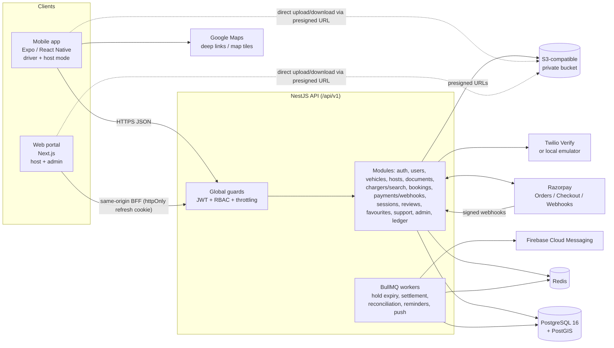
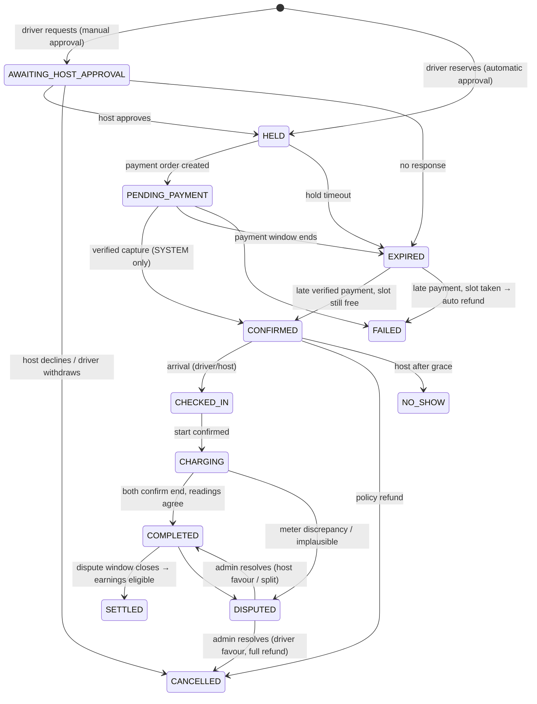
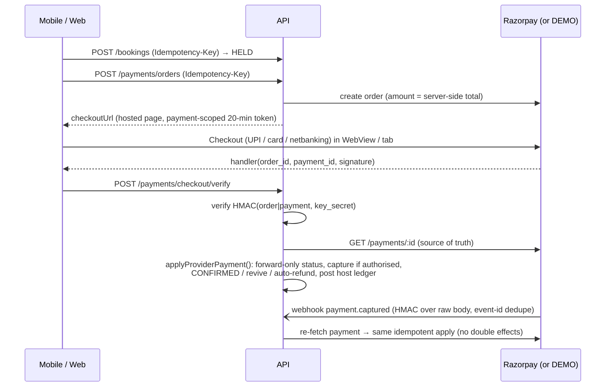

# Architecture

## System overview

## Principles

- **The server decides.** Payment success, booking state, availability, pricing and authorisation are computed server-side. Clients never report "paid"; checkout callbacks are signature-verified and the payment is re-fetched from the provider.
- **One state machine.** `packages/shared/src/booking-state-machine.ts` defines every allowed booking transition and which actor type may trigger it. All status changes in the API go through `BookingTransitionsService`, which applies compare-and-set on `(id, status, version)` and writes an immutable `BookingStatusEvent`.
- **Database-enforced invariants.** No double booking (GiST exclusion constraint over `[startAt, blockedUntil)` for capacity-holding statuses), one live payment per booking (partial unique index), CHECK constraints on money and durations, append-only audit log (trigger). Application checks exist for friendly errors; the database is the guarantee.
- **Integer money and energy.** Paise and Wh everywhere; basis points for rates. No floats in billing.
- **Privacy by default.** Public APIs expose an approximate location (random 200–500 m offset generated once and stored). Exact address and access instructions are AES-256-GCM encrypted at rest and revealed only to the confirmed driver near start time (audited), the host and staff.
- **Honest UI.** No fake telemetry, no remote start/stop, estimates labelled as estimates, DEMO payments and SAMPLE listings labelled everywhere.

## Booking lifecycle

`AVAILABLE` from the product brief is a property of a slot, not a booking row. `AWAITING_HOST_APPROVAL` was added for hosts who approve manually; drivers pay only after approval.

Holds expire consistently in two places: lazily inside every booking-creation transaction for the affected charger (so a stale hold never blocks a new booking) and every minute by a BullMQ job.

## Payment flow

Reconciliation jobs poll Razorpay for payments stuck in CREATED/AUTHORIZED and refunds stuck in PENDING, so a lost webhook or closed app still converges.

## Metering & sessions

There is **no hardware integration** in this release. `ChargerAdapter` (`apps/api/src/modules/sessions/adapters`) defines the boundary for a future OCPP integration; every charger uses `ManualMeterAdapter`, which refuses remote start/stop and live readings. Sessions are confirmed by both parties; for per-kWh bookings both must enter start/end readings. The shared `assessReadings()` compares deltas against a tolerance (max of absolute Wh and a percentage) and a physical plausibility ceiling (max power × duration + headroom). Agreement bills the **lower** reading; anything else opens a `METER_DISCREPANCY` dispute and holds the payout.

## Money: ledger and payouts

Host earnings are an append-only ledger with deterministic idempotency keys (`capture:<paymentId>:<TYPE>`, `refund:<refundId>:<TYPE>`), so retries cannot double-post.

`PENDING` (booking not settled) → `ELIGIBLE` (dispute window passed — owed, **not paid**) → `IN_PAYOUT` (admin batched it) → `PAID_OUT` (admin recorded a bank UTR / provider reference). Automated split settlement (e.g. Razorpay Route) is not used because it needs separate merchant onboarding; payouts are admin-managed and never shown as paid without a reference.

## Auth & sessions

Phone OTP (Twilio Verify in production, local emulator in development — refused in production). Codes are HMAC-hashed; per-phone/per-IP DB limits, resend cooldown and attempt lockout. Access tokens: 15-min HS256 JWT. Refresh tokens: opaque, SHA-256-hashed in the DB, rotated on every use with family-wide revocation on reuse. Web keeps the refresh token in an httpOnly SameSite=Strict cookie via Next.js route handlers; mobile keeps it in the OS keychain (SecureStore). Every request reloads the user, so suspensions take effect immediately.

## Code map (API)

| Module | Responsibility |
|---|---|
| `common/` | env validation, Prisma, JWT guard + `@Roles`, errors/filter, audit, idempotency, crypto, Redis |
| `auth`, `users` | OTP providers, tokens, profile, devices, deletion request |
| `vehicles`, `hosts`, `documents`, `storage` | catalog + vehicles, host onboarding/KYC submission, signed uploads with magic-byte checks |
| `chargers` | host CRUD, availability, PostGIS search, public detail, mappers |
| `booking-core`, `bookings` | transitions/holds, quote/create/approve/cancel/check-in/no-show/access/receipt |
| `payments` | provider registry (Razorpay/DEMO), orders, checkout page, verification, webhooks, refunds |
| `sessions` | both-party confirmation, readings, evidence, completion, kWh settlement |
| `ledger` | host ledger, earnings summary, payouts |
| `reviews`, `favorites`, `support` | reviews, favourites, tickets, incidents (auto-suspend), disputes |
| `admin` | verification queues, moderation, finance, disputes, settings, audit, exports, geo |
| `jobs` | BullMQ schedulers and push delivery |
