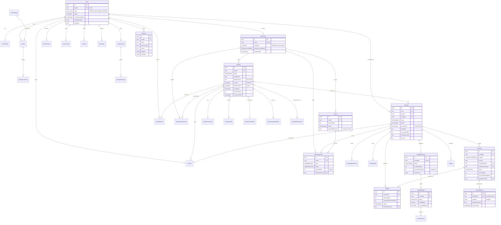

# Database

PostgreSQL 16 + PostGIS 3.4, managed with Prisma (`apps/api/prisma/schema.prisma`). Things Prisma can't express live in hand-written SQL in `prisma/migrations/20261020000100_spatial_and_integrity`.

Conventions: UUID primary keys; all timestamps `timestamptz` in UTC (display in IST at the edge); money in integer **paise**; energy in integer **Wh** (meter readings stored as `numeric(12,3)` kWh as entered, converted to Wh for billing); rates in basis points; snake_case plural table names with camelCase columns; enum values identical to `packages/shared/src/enums.ts` (unit-tested).

## ERD

Supporting tables not shown above: `otp_challenges`, `idempotency_records`, `platform_settings`, `support_messages`, `disputes`, `charger_verifications`, `vehicle_models`.

## Integrity rules enforced by the database

| Rule                                                                                                 | Mechanism                                                                                                                                                                                    |
| ---------------------------------------------------------------------------------------------------- | -------------------------------------------------------------------------------------------------------------------------------------------------------------------------------------------- |
| No overlapping capacity on a charger (holds and confirmed bookings alike, including the host buffer) | `EXCLUDE USING gist ("chargerId" WITH =, tstzrange("startAt","blockedUntil",'[)') WITH &&) WHERE status IN (AWAITING_HOST_APPROVAL, HELD, PENDING_PAYMENT, CONFIRMED, CHECKED_IN, CHARGING)` |
| Contending inserts don't deadlock                                                                    | per-charger `pg_advisory_xact_lock` in the booking transaction                                                                                                                               |
| At most one live payment per booking                                                                 | partial unique index on `payments("bookingId") WHERE status IN (AUTHORIZED, CAPTURED, PARTIALLY_REFUNDED)`                                                                                   |
| Totals add up; no negative money                                                                     | CHECK `totalMinor = chargingFee + serviceFee + serviceFeeTax`, amounts ≥ 0, refunded ≤ amount                                                                                                |
| A payout can't be PAID without a bank/provider reference                                             | CHECK on `payouts`                                                                                                                                                                           |
| A charger can't be VERIFIED without an approval timestamp, or published unless VERIFIED              | CHECKs on `chargers`                                                                                                                                                                         |
| A host can't be identity-VERIFIED without a timestamp                                                | CHECK on `host_profiles`                                                                                                                                                                     |
| One open dispute per booking                                                                         | partial unique index                                                                                                                                                                         |
| Audit log is append-only                                                                             | `BEFORE UPDATE OR DELETE` trigger raising an error                                                                                                                                           |
| Webhook events processed once                                                                        | unique `payment_events.dedupeKey`                                                                                                                                                            |
| Ledger postings idempotent                                                                           | unique `host_ledger_entries.idempotencyKey`                                                                                                                                                  |
| Booking creation idempotent per driver                                                               | unique `(driverId, idempotencyKey)`                                                                                                                                                          |

## Spatial

`chargers.location` (exact, private) and `chargers.publicLocation` (approximate, public) are `geography(Point,4326)` with GiST indexes. Search uses `ST_DWithin(publicLocation, point, radius)` with KNN ordering `publicLocation <-> point`. Distances shown to drivers are to the approximate point and labelled approximate. The admin geo view aggregates public coordinates by city only.

## Migrations

`prisma migrate dev` reports drift because PostGIS creates its own tables in `public`. Generate SQL with `prisma migrate diff --from-migrations prisma/migrations --to-schema-datamodel prisma/schema.prisma --shadow-database-url <empty PostGIS database> --script` into a new migration folder and apply with `prisma migrate deploy` (also what CI/production run).
